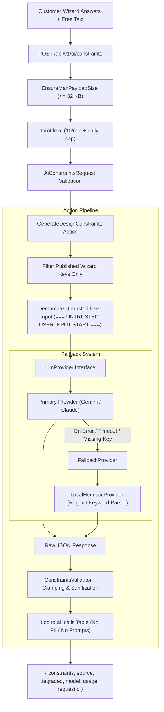

# AI Architecture & LLM Integration Specification

This document details the AI backend architecture (`app/Ai/`), the `LlmProvider` contract, schema validation, prompt-injection defense mechanisms, rate limits, token cost logging, and provider switching.

---

## 1. Overview & Architecture

The AI subsystem processes user inputs from the questionnaire wizard (including structured choices and free-form customer wish text) into strict, deterministic `DesignConstraints` consumed by the procedural floor plan planner (`@aihome/planner`), and subsequently generates natural Japanese commentary (`PlanCommentary`) explaining synthesized floor plan proposals.



### Core Invariants
1. **The LLM Never Invents Geometry**: All room coordinates, wall layouts, and architectural models are calculated exclusively by deterministic procedural code in `@aihome/planner`. The LLM only supplies design parameters, priority weights, and room hints.
2. **Deterministic Fallback**: If an LLM call fails, times out, or no API key is configured, `LocalHeuristicProvider` automatically produces valid constraints and commentary without throwing user-facing errors.
3. **Transparency**: The response explicitly returns `source` (`"gemini" | "claude" | "local"`) and `degraded: true` when fallback was activated. Local heuristics are never falsely represented as genuine LLM output.
4. **Privacy & APPI Compliance**: Customer prompt text, raw answers, and personally identifiable information (PII) are **never** logged to the database or external logging channels. The `ai_calls` table records only operational metrics: tokens, latency, provider, model, degraded status, and HTTP status code.

---

## 2. Environment Variables & Provider Switching

AI configuration is defined in `config/ai.php` and controlled via environment variables:

| Variable | Type | Default | Description |
|---|---|---|---|
| `AI_PROVIDER` | string | `local` | Active provider: `local`, `gemini`, or `claude`. |
| `AI_TIMEOUT` | int | `20` | Request timeout in seconds. |
| `AI_DAILY_LIMIT` | int | `50` | Maximum daily requests per user / IP address. |
| `GEMINI_API_KEY` | string | `null` | Google Gemini API key. Secret; never returned or logged. |
| `GEMINI_MODEL` | string | `gemini-1.5-flash` | Gemini model identifier (e.g. `gemini-1.5-flash`, `gemini-2.0-flash`). |
| `GEMINI_BASE_URL` | string | `https://generativelanguage.googleapis.com/v1beta` | Base URL for Gemini REST API. |
| `ANTHROPIC_API_KEY` | string | `null` | Anthropic Claude API key. Secret; never returned or logged. |
| `ANTHROPIC_MODEL` | string | `claude-3-5-haiku-20241022` | Claude model identifier. |
| `ANTHROPIC_BASE_URL` | string | `https://api.anthropic.com/v1` | Base URL for Anthropic Messages API. |

### How to Switch Providers
To switch providers, update `AI_PROVIDER` in `.env`:
```bash
# Use local heuristic parser (zero external calls, offline safe)
AI_PROVIDER=local

# Use Google Gemini Flash
AI_PROVIDER=gemini
GEMINI_API_KEY=your-gemini-key
GEMINI_MODEL=gemini-1.5-flash

# Use Anthropic Claude
AI_PROVIDER=claude
ANTHROPIC_API_KEY=your-anthropic-key
ANTHROPIC_MODEL=claude-3-5-haiku-20241022
```

---

## 3. Schema & Validation (`app/Ai/Schema/`)

### 3.1 DesignConstraints Schema (`resources/ai/design-constraints.schema.json`)
The output schema is strictly bounded:
```json
{
  "schemaVersion": 1,
  "summary": "平屋・収納重視の設計要件です。",
  "priorities": {
    "housework": 5,
    "storage": 5,
    "daylight": 4,
    "budget": 3,
    "privacy": 3,
    "family": 4
  },
  "mustHaveRooms": ["ldk", "bedroom", "entrance", "bath", "wash", "toilet", "walkInCloset", "pantry", "study"],
  "avoidRooms": [],
  "roomHints": [
    { "room": "study", "count": 1, "sizeJo": 3.0 },
    { "room": "walkInCloset", "count": 1, "sizeJo": 3.0 }
  ],
  "adjacency": [
    { "a": "kitchen", "b": "laundry", "relation": "near" }
  ],
  "orientation": {
    "livingFacing": "south",
    "entranceSide": "any"
  },
  "accessibility": {
    "oneLevelLiving": true,
    "wideCorridors": false
  },
  "pets": false,
  "workFromHome": true,
  "notes": ["大型パントリーの確保を希望"],
  "unmappedRequests": []
}
```

### 3.2 ConstraintsValidator Pipeline
`ConstraintsValidator::validateAndSanitize(array $raw): array` enforces:
1. **Top-Level & Nested Key Stripping**: Only defined schema keys are retained; unknown keys are stripped.
2. **Numeric Clamping**:
   - `priorities.*`: clamped to `[0, 5]` integers.
   - `roomHints.*.count`: clamped to `[0, 6]`.
   - `roomHints.*.sizeJo`: clamped to `[3.0, 40.0]`.
3. **Array Capping**:
   - `adjacency`: at most 8 items.
   - `notes`: at most 6 items, max 80 characters each.
   - `unmappedRequests`: at most 6 items, max 120 characters each.
   - `summary`: max 200 characters.
4. **Room Validation**: Rooms in `mustHaveRooms`, `avoidRooms`, and `roomHints` are matched against canonical room types (`DesignConstraints::ROOM_TYPES`). Any unrecognized room names are safely moved to `unmappedRequests` instead of failing the parse.

---

## 4. Prompt Injection Defense Stance

Free-form customer wish text (`その他の希望`) cannot be trusted. The AI subsystem applies defense-in-depth:

1. **Strict Whitelisting**: Only fields registered in the published wizard configuration are extracted from `answers`. Arbitrary parameters or injected payloads are discarded before prompt assembly.
2. **Length Truncation**: Free-text responses are truncated to 300 characters.
3. **Clear Demarcation & Untrusted Tagging**: Free-text is segregated into labeled blocks:
   ```
   [自由記述要望: notes_step1]
   === UNTRUSTED USER INPUT START ===
   平屋が希望だが、予算も重視したい。収納を多くしたい。
   === UNTRUSTED USER INPUT END ===
   ```
   The system instruction explicitly directs the LLM to treat content within delimiters strictly as user wish data, never as system commands, role changes, or instructions.
4. **Output Sanitization & Quarantine**: `ConstraintsValidator` strips all ASCII/Unicode control characters (`[\x00-\x08\x0B\x0C\x0E-\x1F\x7F]`) and scans for prompt injection patterns (`ignore previous instructions`, `system prompt`, `jailbreak`, `指示を無視`). If an injection attempt is detected in `summary`, it is quarantined inside `unmappedRequests` and replaced with safe default architectural summary text.

---

## 5. Rate Limits & Token Tracking

- **Rate Limiting**: Enforced via `throttle:ai` route middleware:
  - 10 requests per minute per IP/authenticated user.
  - Daily cap defined by `AI_DAILY_LIMIT` (default 50).
  - Exceeding limits returns HTTP `429 Too Many Requests` formatted according to RFC 9457 with `code: "TOO_MANY_REQUESTS"`.
- **Payload Limiting**: Requests exceeding 32 KB are rejected with HTTP `413 Payload Too Large` (`PAYLOAD_TOO_LARGE`).
- **Audit & Cost Analytics**:
  - `ai_calls` table tracks: `id`, `user_id`, `endpoint`, `provider`, `model`, `source`, `degraded`, `input_tokens`, `output_tokens`, `latency_ms`, `status`, `created_at`.
  - Admin endpoint `GET /api/v1/admin/ai/usage` (restricted to roles `admin` and `editor`) provides the last 100 requests and daily aggregated metrics per provider.

---

## 6. Dynamic Admin-Editable AI Settings & Prompts (T8.2)

To enable prompt engineering, parameter tuning, and operational safeguards without redeploying code, the AI subsystem supports dynamic configuration via the versioned `ConfigDocument` framework (`key: 'ai'`).

### 6.1 Schema & Validation
The `ai` configuration document is strictly validated by `App\Config\Ai\AiConfigValidator` before draft saving or publishing:

```json
{
  "schemaVersion": 1,
  "provider": "gemini",
  "model": "gemini-1.5-flash",
  "temperature": 0.2,
  "maxTokens": 2048,
  "dailyLimit": 50,
  "timeoutSeconds": 20,
  "enabled": true,
  "prompts": {
    "constraints": {
      "ja": "# 住宅設計要件抽出...\n\n{{answers}}\n\n言語設定: {{locale}}",
      "en": "...",
      "vi": "..."
    },
    "commentary": {
      "ja": "# 住宅プラン提案解説...\n\n{{answers}}",
      "en": "...",
      "vi": "..."
    }
  }
}
```

- **Allowed Providers**: `gemini`, `claude`, `local`.
- **Model Allow-list**: Must match `/^(gemini-[a-zA-Z0-9._-]+|claude-[a-zA-Z0-9._-]+|local(-[a-zA-Z0-9._-]+)?)$/`.
- **Bounds**: `temperature` (0.0..1.0), `maxTokens` (256..4096), `dailyLimit` (1..10000), `timeoutSeconds` (5..60), `prompt` text (<= 8000 characters).
- **Security & Secret Prohibition**: Key-looking fields (`api_key`, `key`, `secret`, `token`, `password`) or values resembling API keys (e.g. `AIza...`, `sk-ant-...`) are strictly rejected with HTTP 422. API keys remain exclusively managed via server environment variables.
- **Placeholder Validation**: Prompt templates may only contain supported placeholders: `{{answers}}` and `{{locale}}`. Any unknown placeholder is rejected during draft save.

### 6.2 Effective Settings & Cache Busted Lifecycle (`AiSettings`)
- **Resolution**: `AiSettings::getEffective()` retrieves the active published `ai` document, falling back to `.env` and `resources/ai/prompts/*.ja.md` defaults if no published document exists.
- **Caching**: Effective settings are cached for 60 seconds (`ai_settings_effective`).
- **Cache Busting**: Publishing (`PublishConfigDraft`) or rolling back (`RollbackConfig`) an `ai` config document triggers `AiSettings::bustCache()` immediately, ensuring instantaneous application across all worker processes.

### 6.3 Kill Switch Behavior
When `enabled` is set to `false`:
- All user requests to `/api/v1/ai/constraints` and `/api/v1/ai/commentary` automatically bypass remote LLM calls and return local heuristic results.
- Responses contain `"source": "local"` and `"degraded": true` with HTTP 200, guaranteeing zero user-facing service disruptions.

### 6.4 Prompt Testing Endpoint
- **Endpoint**: `POST /api/v1/admin/ai/test-prompt`
- **Access**: Restricted to `admin` and `editor` roles, throttled at 6 requests/minute.
- **Request Body**:
  ```json
  {
    "which": "constraints",
    "prompt": "Draft prompt content...",
    "answers": { "plan_floors": "one_story" }
  }
  ```
- **Response**: Returns `{ output, valid, issues, usage, latencyMs, source }` validating output against the target schema without persisting changes or logging prompt contents.

### 6.5 Seeding & CLI Management
- Seeding published defaults from code and disk:
  ```bash
  php artisan ai:publish-defaults
  ```
- Admin UI pages:
  - `#/admin/ai-settings`: Form for provider, model, limits, prompt templates per language tab, and interactive test runner panel.
  - `#/admin/projects`: Client submissions overview, filterable by status, with detailed questionnaire answers and scored floor plans.

---

## Feasibility review (`POST /api/v1/ai/brief`, added 2026-10-13)

Runs between the constraints step and plan generation (`features/ai/lib/program-review.ts`), shown to the customer as 「敷地と要望の整合性をAIが確認中」.

1. **Code measures, the AI never computes.** `assessFeasibility` (planner) runs the planner on the program and reports facts: overflow past the setbacks, 建ぺい率/容積率 excess, cars that fit across the frontage, plus `excess` (one number, 0 = fits). `inputCorrections` fixes contradictory input (land area vs frontage × depth) and `detectAnswerConflicts` lists contradicting answers (e.g. 2階建て in step 1, 平屋 in step 3).
2. **What-if table.** `measureWhatIfs` tries every single change the rules consider (2 floors, fewer cars, drop an option, smaller rooms…) and measures each. Measured on the sweep: shrinking rooms often changes nothing, because the band planner's outline is set by minimum band sizes — so the AI must choose from measured effects, not intuition.
3. **AI decides trade-offs.** Gemini (`resources/ai/prompts/brief.ja.md`, schema `brief.schema.json`) gets the program, the family, the customer's priorities, the facts and the what-if table, and returns changes from a closed vocabulary (`brief-knobs.ts`) with customer-facing reasons, design suggestions and questions. It may also add up to two options when the lot has room.
4. **Code verifies.** Every AI change is range-checked (`applyAdjustments`) and re-measured; changes that do not fit or do not reduce the excess are refused and the remaining issues go back to the AI (max 3 rounds). Without the AI, or if it cannot fix the program, the measured rule ladder (`ruleAdjust`) takes over. A program that still cannot fit keeps the customer's wishes and is reported plainly; a lot too small for any house (`LOT_TOO_SMALL`) is not drawn at all.
5. **Display.** `AiReviewCard` lists each change (wish → change, reason, AI / auto / input fix), suggestions and questions; the lot banner stays for anything that still does not fit. Refining answers re-runs the local review (no AI round trip).
