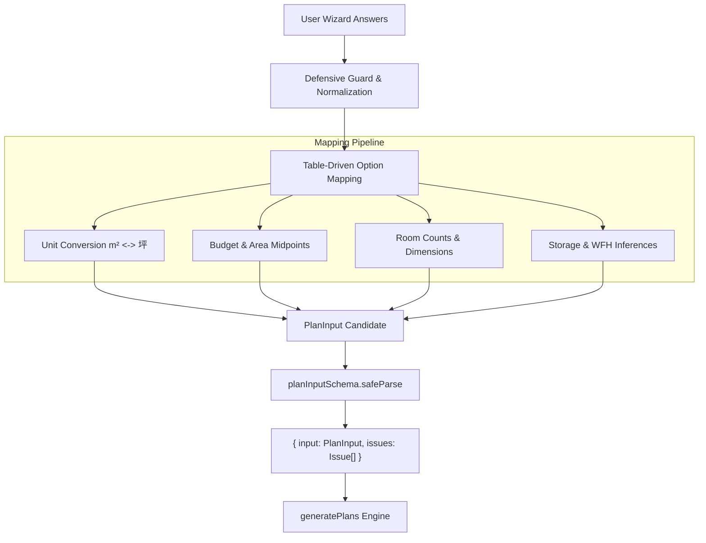

# AI HOME PLATFORM — Wizard Answers to PlanInput Mapping Specification

This document details the mapping layer (`mapAnswersToPlanInput`) in `@aihome/planner` that translates customer wizard answers into a strictly-validated `PlanInput` model for procedural floor plan synthesis (`generatePlans`).

---

## 1. Architecture Overview



The mapping layer guarantees:
1. **Never Throws**: Malformed, hostile proxies, null, or missing keys degrade gracefully to safe architectural defaults.
2. **Table-Driven Transformation**: Option slugs (`one_story`, `size_18`, `cars_2`) are resolved through explicit lookup tables.
3. **Unit Invariance**: Area entries in either `坪` or `m²` are converted automatically using the standard Japanese constant `1 坪 = 3.305785 m²`.
4. **Issue Transparency**: Whenever values are clamped, defaulted, or converted, structured `Issue` records are returned alongside `input`.

---

## 2. Table-Driven Value Mappings

### 2.1 Floors & Plan Type
| Wizard Option Slug | Target `floors` | Issue / Architectural Note |
| :--- | :---: | :--- |
| `one_story` | `1` | Single-storey bungalow (平屋) layout |
| `two_story` | `2` | Two-storey standard family layout |
| `three_story` | `2` | Emits `FLOORS_THREE_STORY_FALLBACK` (3-story reserved for future BDM v2.0) |
| `consult` / `other` | `2` | Safe family default |

### 2.2 Budget Ranges to Midpoints (万円)
Customer responses in `budget_range` are mapped to representative midpoint values:
| Option Slug | Label Range | Midpoint Value | Rationale |
| :--- | :--- | :---: | :--- |
| `budget_under_1500` | 1,500万円未満 | `1,200` 万円 | Midpoint of typical 900–1,500万円 compact home budget |
| `budget_1500_2500` | 1,500万〜2,500万円 | `2,000` 万円 | Standard builder low-mid range |
| `budget_2500_3500` | 2,500万〜3,500万円 | `3,000` 万円 | National median detached family home budget |
| `budget_3500_5000` | 3,500万〜5,000万円 | `4,250` 万円 | Premium / high-spec custom home band |
| `budget_over_5000` | 5,000万円以上 | `6,000` 万円 | Entry baseline for luxury custom builds |
| `budget_undecided` | まだ決まっていない | `3,500` 万円 | Standard Japanese average detached home construction cost |

*If numeric `budget.total` is directly supplied, it is clamped to `[500, 20000]` 万円.*

### 2.3 Desired Floor Area Ranges to Midpoints (坪)
When `plan_target_area` is unspecified, `target_area_range` provides the floor area baseline:
| Option Slug | Label Range | Target Area | Rationale |
| :--- | :--- | :---: | :--- |
| `area_under_25` | 25坪未満 | `22.5` 坪 (~74.4 m²) | Compact 2LDK/3LDK single or couple layout |
| `area_25_30` | 25〜30坪 | `27.5` 坪 (~90.9 m²) | Midpoint for efficient 3LDK family home |
| `area_30_35` | 30〜35坪 | `32.5` 坪 (~107.4 m²) | Standard 4LDK family home size |
| `area_35_40` | 35〜40坪 | `37.5` 坪 (~124.0 m²) | Spacious 4LDK/5LDK with walk-in storage |
| `area_over_40` | 40坪以上 | `45.0` 坪 (~148.8 m²) | Large custom estate baseline |
| `area_unknown` | わからない・相談したい | `32.0` 坪 (~105.8 m²) | National median for newly-built detached residences |

*When specified as a numeric value or with `m²`, `m2ToTsubo` converts the metric area (`areaM2 / 3.305785`).*

### 2.4 Room Dimensions & Counts
| Wizard Field | Option Slug | Mapped Value | Unit |
| :--- | :--- | :---: | :--- |
| `plan_ldk_size` | `size_14`, `size_16`, `size_18`, `size_20`, `size_22`, `size_24_plus`, `consult` | `14, 16, 18, 20, 22, 24, 18` | 帖 (Tatami) |
| `plan_master_bedroom_size` | `size_6`, `size_7`, `size_8`, `size_10`, `size_12_plus`, `consult` | `6, 7, 8, 10, 12, 8` | 帖 (Tatami) |
| `plan_kids_room_count` | `count_0`, `count_1`, `count_2`, `count_3`, `count_4_plus` | `0, 1, 2, 3, 4` | Rooms |
| `plan_kids_room_size` | `size_4_5`, `size_5`, `size_6`, `size_8`, `consult` | `4.5, 5, 6, 8, 6` | 帖 (Tatami) |
| `plan_tatami_count` | `count_0`, `count_1`, `count_2` | `0, 1, 2` | Rooms |
| `plan_tatami_size` | `size_3_4_5`, `size_6`, `size_8_plus`, `consult` | `リビング続き4.5帖, リビング続き6帖, 和室8帖, リビング続き4.5帖` | Label |
| `plan_parking_count` | `none`, `cars_1`, `cars_2`, `cars_3`, `cars_4_plus` | `0, 1, 2, 3, 4` | Vehicles |
| `road_side` | `north`, `south`, `east`, `west` | `北, 南, 東, 西` | Direction |
| `land_shape` | `rectangle`, `square`, `irregular`, `unknown` | `長方形, 正方形, 変形, 長方形` | Shape |
| `plan_bath` | `size_1_0`, `size_1_25`, `size_1_5` | `1坪, 1.25坪, 1.5坪` | Unit size |
| `plan_toilet` | `one_floor`, `two_floors`, `three_or_more` | `1, 2, 3` (Adjusted to 1 for 1-storey) | Count |
| `plan_kitchen` | `counter`, `separated`, `island` | `対面, 独立, アイランド` | Layout |

---

## 3. Storage, WFH & Feature Inferences

1. **Storage Level (`storageLevel`)**:
   - `plan_storage` with >= 3 items (e.g. `walkin_closet`, `pantry`, `shoes_cloak`): inferred as `大容量希望`.
   - `plan_storage` empty: inferred as `最小限`.
   - Otherwise: `標準`.
2. **Closet Configurations**:
   - `masterCloset`: `ウォークイン` if `walkin_closet` selected, else `クローゼット`.
   - `shoesCloset`: `ウォークスルー` if `shoes_cloak` selected, else `収納型`.
   - `storageOpts`: Includes `階段下収納` if `under_stairs` selected on a 2-storey house.
3. **Telework / Study Room (`wfh`, `extraRooms`)**:
   - Inferred as `書斎が必要` and adds `書斎` to `extraRooms` if `life_work === 'dedicated_room'`, `plan_study_count >= 1`, or `life_spaces.includes('workspace')`.
4. **Water Amenities (`waterOpts`)**:
   - Standard defaults: `['ランドリールーム', 'パントリー']`.
   - Automatically added if `short_laundry_flow` or `pantry` are marked in lifestyle preferences.

---

## 4. Coverage Report

### 4.1 Unconsumed Wizard Fields (Retained for Presentation / CRM / 3D Specs)
The following 21 fields collected in the wizard are not consumed by the procedural 2D floorplan solver:

| Wizard Field Key | Category | Reason & Retention Destination |
| :--- | :--- | :--- |
| `construction_purpose` | CRM Notes | New-build vs remodel workflow routing. |
| `house_type` | Future Expansion | Custom vs rental combo; planner generates single-family layouts. |
| `notes_step1` | CRM Notes | Free-form customer notes stored for builder consultation. |
| `land_location` | Civil / Structural | Municipal address used for regional land pricing and GIS zoning data. |
| `road_width` | Civil / Structural | Road width diagonal setback verification, evaluated in 3D clearance. |
| `land_elevation` | Civil / Structural | Topographical site slope used for foundation and retaining wall design. |
| `land_surroundings_other` | CRM Notes | Free-form neighbor and site condition details. |
| `land_survey_file` | Civil / Structural | Uploaded PDF / CAD land surveys for licensed architect review. |
| `plan_ldk_count` | Future Expansion | Multiple LDK separation for multi-family duplexes. |
| `plan_master_bedroom_count` | Future Expansion | Dual master suites for multi-generation households. |
| `plan_other_room_count` | `extraRooms` | Allocates guest room (`客間`) in program when count > 0. |
| `plan_other_room_size` | `extraRooms` / Sizing | Sets target dimensions for guest room (`客間(size)`). |
| `life_pets` | `extraRooms` | Adds mudroom storage (`土間収納`) for pet care when pets are present. |
| `life_future` | `twoGen` | Sets multi-generation plan adaptation (`あり`). |
| `life_notes` | CRM Notes | Free-form lifestyle notes stored for architect review. |
| `design_exterior_wall_color` | Styling & Materials | Wall color finish applied directly to the 3D WebGL exterior renderer. |
| `design_roof_color` | Styling & Materials | Roof finish color applied to the 3D WebGL exterior renderer. |
| `design_flooring_material` | Styling & Materials | Flooring texture (oak, walnut, tile) applied to 3D interior renderer. |
| `design_wall_color` | Styling & Materials | Wall interior finish applied to 3D interior renderer. |
| `design_favorite_photos` | Styling & Materials | Selected moodboard inspiration images. |
| `design_notes` | CRM Notes | Free-form design styling requests. |

### 4.2 Unmapped PlanInput Fields (Safe Architectural Defaults)
The following 10 `PlanInput` fields have no direct customer wizard question and are populated with standard Japanese homebuilding defaults:

| Field Key | Default Value | Rationale |
| :--- | :---: | :--- |
| `roofType` | `'切妻'` | Gabled roof is the standard structural archetype for wooden houses in Japan. |
| `budgetScope` | `'建物のみ'` | Wizard budget figures standardly target the building construction scope. |
| `insulation` | `'等級6'` | HEAT20 G2 high-efficiency thermal insulation baseline. |
| `seismic` | `'等級3'` | Highest structural earthquake-resistance rating in Japanese building standards. |
| `solar` | `'希望'` | Baseline assumption for Net-Zero Energy House (ZEH) compliance. |
| `coverageLimit` | `60`% | Standard residential district building coverage ratio (建ぺい率). |
| `floorRatioLimit` | `200`% | Standard residential district floor area ratio (容積率). |
| `evCharger` | `'なし'` | EV charging outlet defaulted to off unless specifically requested. |
| `kidsCloset` | `'クローゼット'` | Derived from `storageLevel` preset. |
| `bathFloor` | `'1階'` | Standard placement of wet utilities on ground floor. |

---

## 5. API Reference & Usage

```typescript
import { mapAnswersToPlanInput, generatePlans } from '@aihome/planner';

// 1. Map raw wizard answers (from UI state, API JSON, or database record)
const { input, issues } = mapAnswersToPlanInput(customerAnswers);

// 2. Feed validated input directly to procedural planner
const results = generatePlans(input);

console.log(`Generated ${results.plans.length} proposals.`);
if (issues.length > 0) {
    console.log('Mapping adjustments:', issues);
}
```
