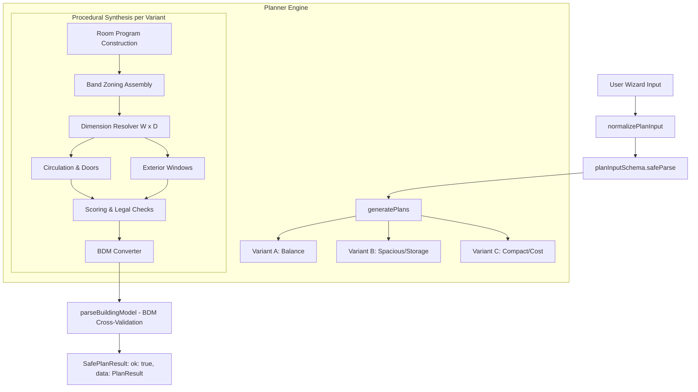

# AI HOME PLATFORM — Planner & BDM Architecture Documentation

This document describes the architectural design, data structures, algorithms, and APIs for `@aihome/bdm` (Building Data Model) and `@aihome/planner` (Floor Plan Generator).

---

## 1. Overview & Architecture

The floor plan generation pipeline in AI HOME is split into two specialized packages:

1. **`@aihome/bdm` (`packages/bdm`)**:
   - Canonical building representation format (BDM v1.0.0).
   - Strict TypeScript schema validation (using Zod) and geometric cross-validation.
   - Zero runtime dependencies outside the workspace `packages/config-schema` (Zod).
   - Version migration utilities and geometric helper algorithms.

2. **`@aihome/planner` (`packages/planner`)**:
   - Deterministic procedural layout engine ported from the original JavaScript prototype.
   - Converts user wizard preferences (`PlanInput`) into 3 viable architectural proposals (`PlanResult`).
   - Generates valid BDM `BuildingModel` instances complete with walls, openings, stairs, and metadata.
   - Computes multi-criteria scores (Housework, Storage, Daylight, Budget) and architectural/zoning warnings.



---

## 2. BDM (Building Data Model) v1.0.0

BDM is the standard exchange format between the procedural planner, the 2D SVG canvas renderer, and the 3D WebGL viewer.

### 2.1 Coordinate System & Units
- **Length unit**: Millimeters (`mm`), integers (`number`).
- **Area unit**: Square meters (`m²`), floating point (`number`).
- **Grid Module**: Standard Japanese 910mm module (`3尺` / `半間`).
- **Origin**: `(0, 0)` is the front-left exterior corner of the building perimeter at ground level.
- **Axes**:
  - `+X`: Left to right across the building frontage.
  - `+Y`: Front to back across building depth.
  - `+Z` (Elevation): Ground level `0mm` up to roof.

### 2.2 Core Schema Entities
- **`BuildingModel`**: Top-level model containing `schemaVersion` (1), `meta`, `site`, `floors`, `roof`, and `warnings`.
- **`Site`**: Site boundary polygon in mm, land area in m², road orientation (`北` / `東` / `南` / `西`), and setback clearances.
- **`Floor`**: Level number (`1`, `2`), elevation and height in mm, arrays of `rooms`, `walls`, `openings`, `fixtures`, and `stairs`.
- **`Room`**: Room ID, recognized room type (`RoomType`), human label, boundary polygon (`Polygon2D`), and calculated net area.
- **`Wall`**: Unique ID, start point `a`, end point `b`, thickness in mm (default `150mm` exterior, `100mm` interior), and kind (`exterior` | `interior` | `bearing` | `partition`).
- **`Opening`**: ID, host `wallId`, linear `offsetMm` from wall start `a`, `widthMm`, `heightMm`, `sillMm`, and kind (`door` | `window` | `slidingDoor` | `entrance` | `largeWindow`).
- **`Stair`**: Start position `(x, y)`, direction, tread count, width, and run.

### 2.3 Validation Pipeline
Validation is performed via `parseBuildingModel(raw: unknown)`:
1. **Pre-check**: High-level bounding verification (floor count <= 10, total element count < 10,000).
2. **Schema Parse**: Strict Zod parsing against `buildingModelSchema`.
3. **Cross-Validation**:
   - Unique IDs across all floors, rooms, walls, and openings.
   - Opening references: Every opening points to an existing wall on the same floor.
   - Opening bounds: `offsetMm >= 0` and `offsetMm + widthMm <= wallLengthMm`.
   - Polygons: Every room polygon is closed and contains >= 3 vertices.
   - Fixture boundary checks.

---

## 3. Floor Plan Generation Algorithm

### 3.1 Input Normalization & Presets
The function `normalizePlanInput` standardizes raw user inputs from either snake_case, dot-notation (`site.frontage`), or legacy camelCase names. It automatically applies wizard defaults:
- **`storageLevel`**:
  - `最小限`: Master CL, Kids CL, Shoes: None, Storage: Under-stairs.
  - `標準`: Master WIC, Kids CL, Shoes: Box type, Storage: Under-stairs.
  - `大容量希望`: Master WIC, Kids WIC, Shoes: Walk-through (SIC), Storage: Family closet, Storage room, Under-stairs, Attic. Automatically adds Pantry.
- **`mustHave` / `notNeeded` overrides**:
  - `アイランドキッチン` sets kitchen type to island.
  - `土間収納` sets shoes closet to walk-through and adds SIC.
  - `書斎` adds a private study.
  - `和室` configures a 4.5-jo Japanese room adjacent to LDK.

### 3.2 Program Sizing & Module Grid
1 module = `910mm`. 1 grid cell = `910mm × 910mm = 0.8281 m²` (approx `0.25 坪` or `0.5 帖`).
- **1 坪** = 4 cells (`2 × 2` modules = `1.82m × 1.82m = 3.3058 m²`).
- **1 帖 (Tatami mat)** = 2 cells (`1.62 m²` standard).

Strict Room Sizing & Customer Matching Rules:
1. **Total floor area** (excluding void, balcony, carport, parking): strictly within **±8%** of target tsubo (midpoint matching across Plans A, B, and C).
2. **Room sizes**: each requested room polygon area strictly within **±1 帖** of requested size (LDK, master bedroom, kids rooms, tatami, study).
3. **No oversized room**: no room may exceed **1.5×** requested jo.
4. **Circulation efficiency**: Hallway & corridor circulation strictly capped at **≤ 6–8%** of floor area (~4 帖 per floor max on 2F) with standard corridor width ≥ 0.91m.
5. **Footprint Sizing**: `sizeFootprint` sizes the building footprint strictly from the customer's **target floor area** (`target tsubo × 3.3058 m² / floors`), NEVER from the lot frontage or depth. Unused site frontage and depth are intentionally preserved as garden, vehicle parking (2.5m × 5.0m stalls), approach walkways, or setback landscaping. The solver explores aspect ratios (width-to-depth ~0.85 to 1.25) matching the target cell count while respecting maximum setback boundaries (`frontage - 1.0m`, `depth - 1.4m`), legal coverage (建ぺい率), and floor-area ratio (容積率).
   **Site fit (parking and setbacks):** standard setbacks are 0.5 m at the sides, 1.0 m to the road plus a 5.5 m parking yard, and 1.4 m at the back. `resolveDimensionsOnSite` (`site-fit.ts`) tries, in order, (1) standard setbacks with the parking in front, (2) standard setbacks with the stalls beside the house (house narrows by `cars × 2.5 m + 0.3 m`), (3) tight setbacks — the 5.0 m stall runs from the boundary to the facade and 0.6 m at the back (the Civil Code asks for 0.5 m) — with parking in front, (4) tight setbacks with side parking. The first that fits wins and is recorded on the input as `parkingPlacement` / `setbackMode`, which `to-bdm` turns into the site boundary and setbacks. If none fits (usually the program exceeds the coverage limit), the least-overflowing layout is kept, the validators emit `LAYOUT_OUTSIDE_LOT`, and the result page shows a banner with the overflow in metres. Measure with `scripts/site-fit-sweep.ts`.
6. **Proportional Downscaling**: When requested rooms alone exceed target area, `scaleRoomSizes` proportionally scales rooms down to catalog minimums (LDK: 10帖, Master: 6帖, Kids: 4.5帖, Tatami: 3帖) and emits `ROOM_SIZE_REDUCED:<room>`. If rooms must be omitted, the engine emits `ROOM_DROPPED:<room>`.
7. **Storage Merging**: Adjacent storage cells (closets, pantry, WIC) sharing common boundaries are merged into consolidated functional polygons (`mergeAdjacentStorageRooms`), eliminating fragmented 1-jo storage train compartments.

### 3.3 Band Zoning Assembly
Rooms on each floor are assembled into horizontal functional bands that span the building width `W`:
- **North Band / Wet Zone**: Entrance, stairs, toilet, washroom, bathroom, laundry.
- **South Band / Living Zone**: LDK, Japanese room, living storage / pantry, outdoor deck access.
- **Upper Floor**: Master suite with WIC to the south/east, children's rooms to the south/west, hall and stairs centrally located.

### 3.4 Dimension Resolution
The resolver determines optimal building width `W` and depth `D1` (1F) and `D2` (2F):
- Respects site setbacks (`frontage - 1.0m` maximum width, `landDepth - 1.4m` maximum depth).
- Aligns building aspect ratio to minimize perimeter heat loss while maximizing daylight.
- Supports stepped 2F designs: If `D2 < D1`, the excess 1F roof becomes a shed roof (下屋), and the planner logs `SECOND_FLOOR_SETBACK_INFO`.

### 3.5 Variants
Every run produces three distinct proposals:
| Variant | Name | Focus | Key Modifications |
| :--- | :--- | :--- | :--- |
| **A** | 標準・バランス案 | Standard / Balanced | Direct projection of user desires, balanced zoning, optimal daylit living. |
| **B** | ゆったり・収納充実案 | Spacious / Storage | Band factor 1.10x, adds Family Closet & Void, expands master storage, mirrored layout. |
| **C** | コントラクト・コスト優先案 | Compact / Cost | Band factor 0.92x, deletes luxury features (voids, hobby rooms), optimizes perimeter. |

### 3.6 Multi-Criteria Scoring
Plans are scored from 0 to 100 on four axes:
- **家事動線 (Housework efficiency)**: Short distance between kitchen, laundry, and washroom; bonus for pantry and laundry room.
- **収納量 (Storage capacity)**: Ratio of storage area to total floor area (target 10-15%).
- **採光・通風 (Daylight & Ventilation)**: South-facing window area for LDK and bedrooms.
- **コスト・予算整合性 (Budget compatibility)**: Proximity to user target budget based on construction area estimate.
- **総合スコア (Total score)**: Weighted composite score (`0.30 × Housework + 0.25 × Storage + 0.25 × Daylight + 0.20 × Budget`).

---

## 4. Warning Codes Table

The planner emits structured `BdmIssue` objects when architectural, legal, or sizing boundaries are reached:

| Warning Code | Level | Description |
| :--- | :--- | :--- |
| `TOTAL_AREA_DEVIATION` | `warn` | Total floor area deviates by > 8% from requested target tsubo (or cannot be met even at catalog minimums). |
| `ROOM_SIZE_REDUCED:ldk` | `warn` | LDK size reduced down to catalog minimum due to footprint/area constraints. |
| `ROOM_SIZE_REDUCED:master` | `warn` | Master bedroom size reduced down to catalog minimum due to footprint/area constraints. |
| `ROOM_SIZE_REDUCED:kids` | `warn` | Kids room size reduced down to catalog minimum due to footprint/area constraints. |
| `ROOM_SIZE_REDUCED:washitsu` | `warn` | Tatami room size reduced to catalog minimum (3帖) due to area constraints. |
| `ROOM_DROPPED:study` | `warn` | Study room omitted due to total floor area constraint. |
| `ROOM_DROPPED:wash2` | `warn` | 2nd-floor washroom omitted due to total floor area constraint. |
| `ROOM_DROPPED:family_closet` | `warn` | Family closet omitted due to total floor area constraint. |
| `ROOM_DROPPED:laundry` | `warn` | Dedicated laundry room omitted due to total floor area constraint. |
| `ROOM_DROPPED:pantry` | `warn` | Dedicated pantry omitted due to total floor area constraint. |
| `ROOM_DROPPED:washitsu` | `warn` | Tatami room omitted due to total floor area constraint. |
| `ROOM_DROPPED_DUE_TO_FRONTAGE` | `info` | Room/amenity omitted due to narrow site frontage constraint. |
| `CONSTRAINT_UNSATISFIED` | `info` | Specific upstream constraint could not be satisfied under geometric boundaries. |
| `ROOM_OVERSIZED:ldk` | `warn` | LDK area exceeds 1.5× the customer requested jo size. |
| `BUILDING_EXCEEDS_FRONTAGE` | `warn` | Building width exceeds allowable site frontage minus side setbacks. |
| `BUILDING_EXCEEDS_DEPTH` | `warn` | Building depth exceeds allowable site depth minus front/rear setbacks. |
| `COVERAGE_RATIO_EXCEEDED` | `warn` | Building footprint exceeds zoning building coverage ratio (建ぺい率). |
| `FLOOR_AREA_RATIO_EXCEEDED` | `warn` | Total floor area exceeds zoning floor area ratio (容積率). |
| `SECOND_FLOOR_SETBACK_INFO` | `info` | 2nd floor depth is smaller than 1st floor; remainder resolved as下屋. |
| `ISOLATED_ROOM_DETECTED` | `info` | An enclosed room has no direct opening to adjacent circulation. |

---

## 5. API Reference

### `@aihome/bdm`
```typescript
import {
    parseBuildingModel,
    migrateBuildingModel,
    precheckBdmLimits,
    polygonAreaM2,
    isPointInPolygon,
    doSegmentsIntersect,
    computePolygonBoundingBox
} from '@aihome/bdm';

const parseResult = parseBuildingModel(rawJson);
if (parseResult.ok) {
    console.log('Valid model:', parseResult.data.meta);
} else {
    console.error('Validation issues:', parseResult.issues);
}
```

### `@aihome/planner`
```typescript
import {
    generatePlansSafe,
    generatePlans,
    normalizePlanInput,
    planInputSchema
} from '@aihome/planner';

// Safe execution (never throws)
const result = generatePlansSafe(userWizardState, { cellM2: 0.8281 }, 42);
if (result.ok) {
    const { plans, warnings } = result.data;
    const [planA, planB, planC] = plans;
    console.log('Variant A area:', planA.summary.floorAreaM2);
}
```

---

## 6. Limits, Boundaries & Intentional Differences

1. **Seeded PRNG**: The generator uses a seeded Mulberry32 pseudo-random generator, ensuring identical inputs with the same seed yield bit-for-bit identical BDM structures.
2. **Deterministic Output**: Unlike LLM-based layout generation, geometry calculations are 100% deterministic and cannot hallucinate intersecting exterior walls.
3. **Module Rigidity**: Currently constrained to the Japanese 910mm module grid. Meter-module (1,000mm) support is reserved for future schema versions.
4. **Site Boundary Warnings**: If a requested house size exceeds the lot boundaries, the engine emits `BUILDING_EXCEEDS_FRONTAGE` warnings while preserving valid BDM output so the user can see what needs downsizing.

---

## 7. AI Design Constraints & Plan Conformance

### 7.1 AI Design Constraints (`DesignConstraintsSchema`)
The procedural engine accepts optional structured constraints generated by upstream LLM agents (`DesignConstraints`), allowing the AI to guide room counts, priority weightings, adjacency, accessibility, work-from-home, and variant ordering without violating procedural zoning rules.

- **Schema fields**:
  - `schemaVersion`: Literal `1`.
  - `summary`: Short text (max 200 chars).
  - `priorities`: Weights 0..5 for `housework`, `storage`, `daylight`, `budget`, `privacy`, `family`.
  - `mustHaveRooms` / `avoidRooms`: Whitelist and blacklist of rooms.
  - `roomHints`: Targeted sizing for `ldk`, `master`, `kids`, `tatami`, etc.
  - `adjacency`: Preferred room adjacency pairs (`adjacent` | `separate`).
  - `accessibility`: Flag for `oneLevelLiving` (promotes 1F master) and `wideCorridors`.
  - `pets` / `workFromHome`: Pet-friendly features and dedicated study placement.
  - `notes` / `unmappedRequests`: Preserved context.

If invalid constraints are passed, the planner safely falls back to wizard defaults and records warning code `CONSTRAINTS_INVALID`.

### 7.2 Conformance Checker (`checkPlanConformance`)
Validates that generated plans faithfully honor user answers and applied constraints using strict polygon shoelace geometry across 20 distinct architectural criteria:
1. `storeys`: Exact floor count match (1F / 2F).
2. `floor_area`: Net enclosed floor area (excluding void/balcony) within **±8%** of target tsubo (midpoint), or documents `TOTAL_AREA_DEVIATION`.
3. `room_count_ldk` / `master` / `kids` / `tatami` / `study`: Accurate presence and room counts.
4. `room_size_ldk` / `master` / `kids`: Room polygon area within **±1 帖** (1.62 m²) of requested size, and strictly ≤ 1.5× requested size (no oversized room).
5. `circulation_ratio`: Hallway and corridor circulation strictly **≤ 6%** of total floor area with corridor width ≥ 0.91m.
6. `wet_bath_size` / `wet_toilet_count`: Sanitary fixture and toilet room allocations.
7. `storage_walkin_closet` / `storage_pantry` / `storage_shoe_closet`: Storage amenity presence.
8. `parking_count` / `land_fit`: Parking spaces and site setback conformance.
9. `circulation_reachability` / `stairs_presence`: Hallway connectivity and multi-floor vertical stair alignment.
10. `no_overlapping_rooms`: Non-intersecting interior polygon test using bounding box and ray-casting.

### 7.3 Independent Oracle Benchmark (`scripts/oracle.ts`)
An external oracle independently calculates shoelace polygon areas from raw 2D boundary coordinates and verifies compliance across all three proposals (A, B, and C) across 38 diverse architectural scenarios (small/medium/large areas, 1F/2F, narrow/wide sites, various LDK/bedroom sizes, and amenity combinations). Achieves **114/114 (100%)** pass rate.

---

## 8. Japanese Residential Realism & Proposal Alignment (T6.9)

### 8.1 Numeric Alignment across Proposals A, B, and C
All three generated proposals target the identical total floor area within **±8%** of the customer target tsubo. The proposals differ strictly by layout strategy, daylight orientation, and living circulation—never by arbitrary size inflation:
- **Proposal A (家事動線重視)**: Linear service spine linking Kitchen, Pantry, Laundry, Bath, and Family Closet for streamlined housework.
- **Proposal B (開放感重視)**: Mirrored South/East exposure prioritizing wide garden sightlines, open-plan living, and daylight integration.
- **Proposal C (コスト重視)**: Compact rectangular structural perimeter minimizing exterior corners and optimizing wall efficiency.

### 8.2 Realistic Architectural Principles
1. **Single Unified Hall per Floor**: Hallways are merged into a single contiguous circulation space connecting the entrance, stair landing, and rooms. Corridor width is guaranteed ≥ 0.91m (1 standard module).
2. **Plumbing & Wet Cluster**: Bath, wash/dressing room, laundry, and primary toilet are clustered contiguously along the plumbing service band.
3. **LDK Interior Fixtures**: Realistically scaled architectural fixtures (`kitchen_counter`, `kitchen_island`, `dining_table_4/6`, `sofa`, `tv_board`) are placed without blocking circulation paths.
4. **Natural Lighting & Window Sashes**: Habitable rooms have windows on exterior walls; South LDK features wide panoramic sliding sash openings (`largeWindow`), and the main entrance door is centered on the entrance room façade.
5. **Enclosed Stairwells with Landings**: Multi-story staircases feature dedicated upper and lower landings, preventing dangerous direct door openings onto stair flights.
6. **2F Envelope Integrity**: Upper floor outlines sit strictly within or aligned to the ground floor structural envelope.

### 8.3 Visual Render Pipeline
The SVG debug renderer converts BDM models into architectural drawings complete with Japanese room kanji, tatami counts, wall thicknesses, fixture outlines, and door swings. Renderings for four benchmark test cases across all three proposals (12 plans total) are saved in:
- `docs/design/current/plans/case1_default_2F_30tsubo_[A|B|C].png`
- `docs/design/current/plans/case2_1F_25tsubo_[A|B|C].png`
- `docs/design/current/plans/case3_2F_40tsubo_[A|B|C].png`
- `docs/design/current/plans/case4_narrow_7x14_[A|B|C].png`


---

## Lot-first solver (added 2026-10-13)

`solvePlan` (`solver-*.ts`) is used when every band-planner candidate sticks out of the lot (`LAYOUT_OUTSIDE_LOT`). It sizes the house from the buildable area first and fits the rooms into it:

- **Outline**: searched inside the envelope for each site fit (parking front/side × standard/tight setbacks) and the coverage limit; the narrowest width that packs, scored against the target area and the LDK/bedroom/kids sizes.
- **First floor**: the LDK is one column down the full depth (so it reaches the front and back walls and gets sun whatever the road side; on an east/west road it sits on the sunny side). The rest is a front row (entrance + SIC, stairs, …), a 1-cell hall row, and a back row (pantry next to the LDK, wet block, …). Rooms move between the two rows; the split that shrinks the fewest wished-for cells wins.
- **Stairs**: 2 × 3 upright or 3 × 2 along a 2-deep row, landing always on the hall, same rect on both floors — this is what lets a two-storey house be 6–7 cells deep instead of the band planner's minimum of 8.
- **Second floor**: front row with the stairs pinned, full-width hall row, back row; bedrooms prefer the sunny row; master + WIC are one block. Spare width upstairs becomes an inner balcony (not floor area) rather than fake storage or oversized rooms.
- Output is the AI-layout grid format, so walls, doors, windows, BDM and every geometric check are the existing ones (`checkAiLayout`, `validateLayout`, `lotOverflow`).

Measured (`scripts/site-fit-sweep.ts`, 960 plans): fitting plans 598 → 624; oracle 116/117 (the miss: a variant C with 4.6帖 rooms on a lot it now fits). What is left overflowing is mostly narrow 7–10 m lots with cars, or single-storey programs over the coverage limit — the feasibility review handles those.
